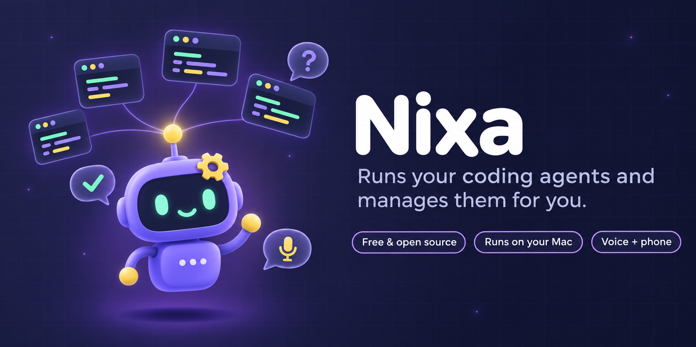

# Nixa



[](LICENSE)
[](#-what-you-need)
[](#-build-from-source)
[](#nixa)
[](https://www.buymeacoffee.com/anandbhandari)
[](https://www.linkedin.com/in/anand-bhandari-b98900164/)
[](https://anandbhandari1.github.io/)

<div align="center">

https://github.com/user-attachments/assets/c2082c4f-b379-49b3-b658-65d114a9b6ad

</div>

Nixa is a free, open source Mac app that runs your coding agents and manages them for you.

You start Claude Code, Codex, OpenCode, Cursor and other agents inside Nixa. Nixa watches every agent, answers their questions by your rules, gives them tasks, reviews their work and tells you only what needs you. You can talk to Nixa by voice or chat, on the Mac or from your phone.

- 🆓 Free and open source, GPL-3.0 license.
- 🏠 Runs on your Mac. No Nixa server. No telemetry.
- 🦀 One app, written in Rust with GPUI.

> ⚠️ **Beta.** Nixa is a beta project and still under heavy development. Features change often, some parts are not finished, and bugs are expected. Do not rely on it for important work yet, and keep backups of your projects.

## 📑 Contents

- [What Nixa does](#-what-nixa-does)
- [What you need](#-what-you-need)
- [Install](#-install)
- [First start](#-first-start)
- [Quick start](#-quick-start)
- [Voice](#-voice)
- [Phone](#-phone)
- [The nixa command](#-the-nixa-command)
- [Settings](#-settings)
- [Privacy and safety](#-privacy-and-safety)
- [Data folder and uninstall](#-data-folder-and-uninstall)
- [Troubleshooting](#-troubleshooting)
- [Build from source](#-build-from-source)
- [Repo layout](#-repo-layout)
- [Contributing](#-contributing)
- [Security](#-security)
- [FAQ](#-faq)
- [Support and contact](#-support-and-contact)
- [Credits](#-credits)
- [License](#-license)

## ✨ What Nixa does

### 🖥️ Spaces and terminals

- One space per project folder, with tabs and split panes.
- Fast GPU terminals. They keep running when you close the window.
- A files panel, a git panel and an editor beside your agents.

### 👀 See every agent at once

- The sidebar shows each agent: working, needs you, done or idle.
- Every agent has a number you can say out loud, for example "agent 3".
- Agents report their own state through small status hooks.

### 💬 Agent questions

- When an agent asks for permission, a plan or a choice, Nixa shows one card for it.
- You answer from the card, or Nixa answers by your rules.
- Risky answers (push, delete, deploy, payments, production) always come to you.

### 🤖 Nixa, your assistant

- Chat or talk with Nixa. It can start agents, give them tasks, read their screens and report back.
- Pick its brain: an API model with your own key, a local model, or a coding agent you already have.
- A stronger "deep brain" helps with hard decisions.

### ✅ Tasks and review

- A shared task board. Nixa starts tasks on free agents and follows them.
- When a task is finished, Nixa reviews the changes and the checks before it closes the task.
- You are asked only when the review is not sure.

### ⚡ Decision models

- Small, fast decision models can answer simple yes or no questions before the chat brain. For example: is this agent waiting, which option fits, is this task done.
- When the model is not sure enough, the chat brain decides as usual.
- A topic guard can refuse messages that are not about code, tech or using Nixa.

### 🛰️ Drones

- Drones are read-only watchers over your tasks and terminals.
- They find stuck or looping agents and tell Nixa.
- A drone step can ask a plain question, for example "Is this terminal stuck in a loop?".

### 🚦 Heavy check slots

- Builds and tests from all agents take turns, by default 2 at a time.
- This keeps the Mac fast when many agents build at once.
- It works by itself in every Nixa terminal for cargo, xcodebuild, gradle, swift, go, npm, pnpm, yarn and bun.

### ➕ More

- Custom agents, each with its own agent, model, effort and standing instructions.
- Workflows on a canvas, schedules, rule trees and repeat messages.
- Connectors for your own outside tools.
- Voices per agent, a wake word and a hold key.

## 📋 What you need

- A Mac with Apple silicon and a recent macOS.
- At least one coding agent, or an API key for a chat brain.
- Optional: an Android phone on the same Wi-Fi, GitHub access, a web search key.

Supported agents:

- Claude Code, Codex, Cursor Agent, Antigravity (agy), OpenCode, Gemini CLI, Kimi, omp, omo, Hermes, Crush, jcode and dim.
- Any other command line agent also runs in a Nixa terminal. Only the list above gets status hooks and a start button.

## 📦 Install

1. Download `Nixa-<version>.dmg` (for example `Nixa-0.1.48.dmg`) from the [latest release](https://github.com/AnandBhandari1/nixa/releases/latest).
2. Open it and drag Nixa to Applications.
3. Open Nixa from Applications. This build is not signed yet, so macOS blocks the first open. Right-click Nixa, choose Open, then Open again. Or run `xattr -dr com.apple.quarantine /Applications/Nixa.app`.
4. Install at least one agent, for example Claude Code or Codex, and sign in to it in a normal terminal once.

## 🚪 First start

- Nixa starts empty. No spaces, tasks, agents, accounts, keys or chat are there until you add them.
- It does not read or import data from other apps.
- macOS asks for these only when you use the feature that needs them:
  - Microphone: voice.
  - Accessibility and Input Monitoring: the hold key, and Nixa's clicks and typing in other apps.
  - Screen Recording: screenshots that Nixa reads.
- Voice needs two speech models (about 490 MB). Nixa downloads them only after you say yes.

## 🚀 Quick start

1. Add a space: pick a project folder.
2. Start an agent from the space, for example Claude Code.
3. Add the status hooks once, so Nixa sees the agent's state:

   ```sh
   nixa hooks install
   nixa hooks install --apply
   ```

   The first line only shows the change. The second line writes it.
4. Give a task: type it in the Nixa chat, or add it to the task board.
5. Answer a question when a card shows up, or let Nixa answer by your rules.

## 🎙️ Voice

- Turn on the mic and Nixa listens for its wake word. You can also use a hold key.
- When you start to speak, Nixa stops talking at once.
- Each agent can have its own voice.
- Voice can play on the Mac or on the phone.
- The voice switch turns all speech off.

Speech to text runs on your Mac. Nothing is sent outside for it.

## 📱 Phone

- The Nixa Android app connects to Nixa on your Mac over your own Wi-Fi.
- Talk to Nixa, hear agents and get their questions on the phone.
- Pair it in Settings → Phone. Nixa trusts only phones you have paired.
- The Android app is a separate project: [nixa-mobile](https://github.com/AnandBhandari1/nixa-mobile). For now you build it yourself, see its README.

## ⌨️ The nixa command

`nixa` is the command line for everything Nixa does. Agents use it too. Inside a Nixa terminal, `NIXA_BIN` holds its path.

Run `nixa help` for the full list, and `nixa help <group>` for one group. That help text is the full reference.

The main groups, with examples:

- term: terminals.
  - `nixa term ls`
  - `nixa term run --wait -- cargo test`
- task: the shared task list.
  - `nixa task ls`
- space: spaces.
  - `nixa space ls`
- chat: talk to Nixa from the command line.
  - `nixa chat help`
- deep: the deep brain.
  - `nixa deep help`
- drones: the watchers.
  - `nixa drones help`
- decide: the decision model setting.
  - `nixa decide test "Is the agent waiting?" --yes-no`
- heavy: heavy check slots.
  - `nixa heavy`
  - `nixa heavy slots 3`
- agent: report usage limits, hand a task over.
  - `nixa agent help`
- tool: every Nixa tool (screen, clicks, browser, web, memory and more).
  - `nixa tool help`
- screenshot: take and read a screenshot.
  - `nixa screenshot help`
- voice and phone: voice switches, voices, devices, pairing.
  - `nixa help voice`
- hooks: status hooks for agents.
  - `nixa hooks status`
- privacy: every way data can leave this Mac. Read only.
  - `nixa privacy`
- engine and brain: start, stop or check the two background parts.
  - `nixa engine stop`
  - `nixa brain stop`

Add `--json` to most commands for machine-readable output.

## ⚙️ Settings

Settings are in three groups.

- Nixa: General, Chat brain, Repeat messages, Memory, Knowledge, Mic and speaker, Voices, Phone, Privacy, Nixa screen.
- Work: Spaces, Agents and team, Workflows, Rules, Decision model, Drones, Heavy checks, Schedules, Git accounts, Web search, Connectors.
- App: Look, App.

## 🔒 Privacy and safety

Read this before you use Nixa.

- Agents start with their own permission checks off by default, so they can work without stopping. An agent can then edit files and run commands in your account. Turn normal checks on for any agent in Settings → General.
- Nixa asks you before risky steps: git push, deletes, starting an agent with checks off, and typing into other apps.
- Everything runs on your Mac. There is no Nixa server and no telemetry.
- Keys stay in the macOS keychain.
- Outside services (API brains, web search, connectors) are off until you turn them on. Each one says what it sends. `nixa privacy` lists all of them.
- You use your own accounts and keys for agents and models. Follow their terms of service.
- Nixa comes with no warranty. Use it at your own risk. See [License](#-license).

## 🗂️ Data folder and uninstall

- Data folder: `~/Library/Application Support/Nixa`.
- A debug build from source uses `.config/nixa` inside the repo folder.
- Set `NIXA_DATA_DIR` to use another folder.
- The brain listens on `127.0.0.1:7421` only. Set `NIXA_BRAIN_ADDR` to change it.

To remove Nixa fully:

1. Remove the status hooks: `nixa hooks remove --apply`.
2. Stop the background parts: `nixa engine stop` and `nixa brain stop`.
3. Quit Nixa and move `/Applications/Nixa.app` to the Trash.
4. Delete `~/Library/Application Support/Nixa`.
5. Remove Nixa's keys from the Keychain Access app, if you saved any.

## 🛠️ Troubleshooting

- An agent shows no state in the sidebar: run `nixa hooks status`, then `nixa hooks install --apply`, and start the agent again. Codex also needs `/hooks` inside Codex to trust the new hooks.
- Voice does not hear you: check the mic in Settings → Mic and speaker, and the Microphone permission in macOS System Settings.
- Nixa does not answer: run `nixa brain status`. Start it again with `nixa brain stop` and reopen Nixa.
- Terminals are gone after a crash: run `nixa engine status`. Reopen Nixa to start the engine again.
- A build waits a long time: run `nixa heavy` to see what holds the slots. `nixa heavy off` turns slots off.
- macOS asks for a permission again after an update: give it again in System Settings → Privacy and Security.

## 🏗️ Build from source

You need macOS on Apple silicon, the Xcode Command Line Tools and Rust 1.99 or newer.

```sh
CARGO_TARGET_DIR=target/gpui cargo build --workspace
```

The first build of the voice crate downloads a prebuilt sherpa-onnx archive. To build offline, set `SHERPA_ONNX_ARCHIVE_DIR` or `SHERPA_ONNX_LIB_DIR`.

Run the window:

```sh
target/gpui/debug/nixa-app
```

The window starts the terminal engine (`nixa-engine`) and the brain (`nixa-brain`) when they are not running. Closing the window does not stop them.

Make the app bundle:

```sh
cargo run -p xtask -- bundle
```

Check and test one crate:

```sh
CARGO_TARGET_DIR=target/gpui cargo clippy -p nixa-brain --all-targets
CARGO_TARGET_DIR=target/gpui cargo test -p nixa-brain
```

## 🧭 Repo layout

- `crates/engine`: the terminal engine.
- `crates/protocol`: messages between the engine, the window, the brain and the command line.
- `crates/app`: the GPUI window.
- `crates/ui`, `crates/termview`: UI parts and the terminal view.
- `crates/brain`: the Nixa brain (chat, tools, tasks, deep brain, drones, decisions, schedules, voice).
- `crates/voice`: microphone, voice activity, speech to text and text to speech.
- `crates/store`: the local database.
- `crates/mcp`: the Nixa MCP server for agents.
- `crates/cli`: the `nixa` command.
- `crates/phone`: the link to the Android app.
- `crates/git`, `crates/editor`, `crates/desktop`, `crates/jsonedit`: the git panel, the editor, desktop eyes and hands, the rule tree editor.
- `crates/xtask`: the build tool for the app bundle.
- `hooks/`: status hooks for agents.

## 🤝 Contributing

We don't take pull requests. Open an issue describing the bug or idea, and our agents usually turn it around fast.

- For a bug: say what you did, what you expected and what happened. Add the Nixa version from `nixa version`.
- For an idea: say what you want to do and why it helps.

## 🛡️ Security

Do not report security problems in a public issue. Use GitHub's private vulnerability report on this repo (Security tab → Report a vulnerability). Say what is wrong and how to reproduce it. You will get an answer as soon as possible.

## ❓ FAQ

- Is Nixa free? Yes. It is free and open source under the GPL-3.0 license.
- Does Nixa send my code anywhere? Nixa itself does not. Your agents and chat brain send what they need to their own services, under your own accounts. `nixa privacy` lists every outside service that is on.
- Which agents work? See [What you need](#-what-you-need).
- Does it work on Intel Macs, Windows or Linux? Not now. Apple silicon Macs come first.
- Do I need to pay for AI? Nixa is free. The agents and models you use have their own plans and prices.

## ☕ Support and contact

Nixa is free. If it helps you, you can support the work.

- ☕ Buy me a coffee: [buymeacoffee.com/anandbhandari](https://www.buymeacoffee.com/anandbhandari)
- 💼 LinkedIn: [Anand Bhandari](https://www.linkedin.com/in/anand-bhandari-b98900164/)
- 🌐 Website: [anandbhandari1.github.io](https://anandbhandari1.github.io/)
- ⭐ Star the repo on GitHub, so more people find it.

<a href="https://www.buymeacoffee.com/anandbhandari"></a>

## 🙏 Credits

Nixa is built on the work of these projects. Thank you.

- gpui by Zed Industries (Apache-2.0): the UI framework.
- alacritty_terminal (Apache-2.0): the terminal core.
- sherpa-onnx by k2-fsa (Apache-2.0): the speech engine.
- Speech to text: Parakeet TDT 0.6B v3 by NVIDIA, CC BY 4.0 (creativecommons.org/licenses/by/4.0). Downloaded on first use, not part of this repo.
- Voice activity: Silero VAD by the Silero Team (MIT).
- Icons: Lucide (ISC), with some Feather icons (MIT).
- Agent marks: LobeHub lobe-icons (MIT).
- Many more Rust crates. Each keeps its own license. The full list is in THIRD_PARTY_LICENSES.html.

Claude Code, Codex, Cursor, Antigravity, OpenCode, Gemini and the other agent names and logos are trademarks of their owners. Nixa is not made by, connected to or supported by them.

## 📄 License

GPL-3.0. Copyright (c) 2026 Anand Bhandari. See [LICENSE](LICENSE).

Nixa is beta software under heavy development. It is given as it is, with no warranty of any kind. Features, settings, commands and data formats may change or be removed between versions without notice. You use it at your own risk.

Third-party code, icons and models keep their own licenses. See THIRD_PARTY_LICENSES.html.
